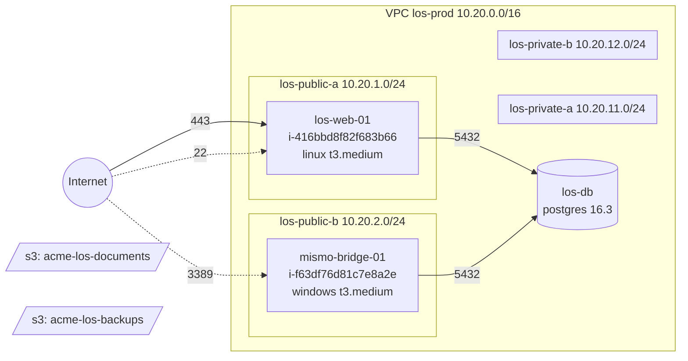

# Takeover report: week one, read-only

Account `123456789012`, region `us-east-1`. Collected with read-only calls only.

| | |
|---|---|
| Resources found | 18 |
| Already in Terraform | 0 |
| Not in Terraform | 18 |
| Findings | 3 critical, 5 high, 6 medium |
| CloudTrail | none |

## Findings

Nothing here is changed without a written change request and the owner's approval.

| Rule | Severity | Resource | Finding | Proposed fix |
|---|---|---|---|---|
| TKO-001 | critical | los-web (sg-6e7fa8ccc2b0f2ebf) | SSH (22) open to the whole internet | Remove the rule; reach hosts through SSM Session Manager (IAM-authenticated, logged in CloudTrail). |
| TKO-002 | critical | mismo-bridge (sg-dc898548d9e3ad093) | RDP (3389) open to the whole internet | Remove the rule; reach hosts through SSM Session Manager (IAM-authenticated, logged in CloudTrail). |
| TKO-009 | critical | prev-admin (prev-admin) | IAM user with full admin and a long-lived access key | Find where the key is used (CloudTrail, last-used date), move that use to a role, then deactivate and delete the key. |
| TKO-003 | high | los-db (los-db) | Database has a public endpoint | Set publicly_accessible = false; only the app and bridge security groups reach it. |
| TKO-004 | high | los-db (los-db) | Database storage and snapshots are not encrypted | Encryption can't be switched on in place: snapshot, copy the snapshot with a KMS key, restore, cut over in a maintenance window. |
| TKO-007 | high | acme-los-documents (acme-los-documents) | No S3 public access block | Add aws_s3_bucket_public_access_block with all four settings on. |
| TKO-010 | high | prev-admin (prev-admin) | IAM user without MFA | Require MFA or replace the user with SSO access. |
| TKO-011 | high | account | No multi-region CloudTrail: there is no record of who changed what | Owner-applied trail to an Object Lock bucket (terraform/guardrails). |
| TKO-005 | medium | los-db (los-db) | Only 1 day(s) of automated backups | Raise retention to at least 14 days and prove it with a quarterly restore test. |
| TKO-006 | medium | los-db (los-db) | Deletion protection is off | Turn on deletion_protection; one wrong apply should not be able to drop the system of record. |
| TKO-008 | medium | acme-los-documents (acme-los-documents) | Versioning is off, so overwrites and deletes are permanent | Enable versioning with a lifecycle rule for old versions. |
| TKO-012 | medium | los-web-01 (i-416bbd8f82f683b66) | IMDSv1 allowed on the instance | Require IMDSv2 tokens (metadata_options.http_tokens = required) after checking the app's SDK versions. |
| TKO-012 | medium | mismo-bridge-01 (i-f63df76d81c7e8a2e) | IMDSv1 allowed on the instance | Require IMDSv2 tokens (metadata_options.http_tokens = required) after checking the app's SDK versions. |
| TKO-013 | medium | los/db-master (arn:aws:secretsmanager:us-east-1:123456789012:secret:los/db-master-TYHoTO) | Secret is never rotated | Enable rotation; for the RDS master password, use RDS-managed rotation. |

## Inventory

| Type | Name | ID | Terraform |
|---|---|---|---|
| `aws_db_instance` | los-db | `los-db` | not managed |
| `aws_db_subnet_group` | los-db-subnets | `los-db-subnets` | not managed |
| `aws_iam_role` | los-app | `los-app` | not managed |
| `aws_iam_user` | prev-admin | `prev-admin` | not managed |
| `aws_instance` | los-web-01 | `i-416bbd8f82f683b66` | not managed |
| `aws_instance` | mismo-bridge-01 | `i-f63df76d81c7e8a2e` | not managed |
| `aws_internet_gateway` | los-prod-igw | `igw-7d0c748f7fe5bdc61` | not managed |
| `aws_s3_bucket` | acme-los-backups | `acme-los-backups` | not managed |
| `aws_s3_bucket` | acme-los-documents | `acme-los-documents` | not managed |
| `aws_secretsmanager_secret` | los/db-master | `arn:aws:secretsmanager:us-east-1:123456789012:secret:los/db-master-TYHoTO` | not managed |
| `aws_security_group` | los-db | `sg-b7c4a8c2b45f75bf7` | not managed |
| `aws_security_group` | los-web | `sg-6e7fa8ccc2b0f2ebf` | not managed |
| `aws_security_group` | mismo-bridge | `sg-dc898548d9e3ad093` | not managed |
| `aws_subnet` | los-private-a | `subnet-c9459af7ddc6458fa` | not managed |
| `aws_subnet` | los-private-b | `subnet-0ae48980642316940` | not managed |
| `aws_subnet` | los-public-a | `subnet-752c5fc1db485df92` | not managed |
| `aws_subnet` | los-public-b | `subnet-430c007d0716c0522` | not managed |
| `aws_vpc` | los-prod | `vpc-edbdc102f4c0572d0` | not managed |

## Diagram

